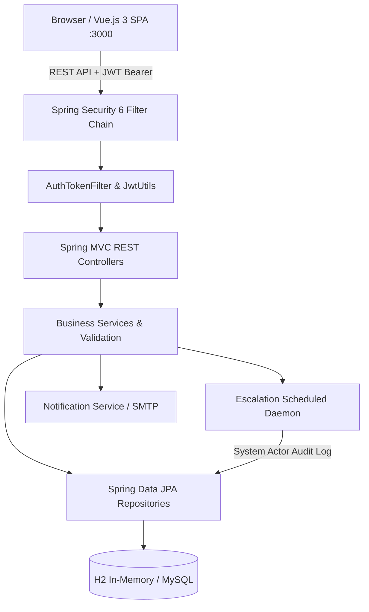

# ResolveIT — Smart Grievance Redressal & Citizen Feedback System

A robust, enterprise-grade full-stack grievance redressal platform engineered with **Spring Boot 3.5**, **Spring Security 6 (JWT)**, and **Vue.js 3**. Built for transparent, accountable governance workflows across municipal corporations, smart cities, and public sector enterprises.

---

## 📌 Problem Statement & Overview

Citizen grievance redressal systems are often hindered by opaque workflows, lack of accountability, and missing audit trails. When complaints sit unassigned or overdue, citizens lose confidence in public administration.

**ResolveIT** solves this by establishing:
- **Strict Role Separation**: Dedicated portals and permissions for Citizens, Department Officers, and Administrative Supervisors.
- **Auditable Complaint Lifecycle**: Every state transition (`NEW` → `UNDER_REVIEW` → `IN_PROGRESS` → `RESOLVED` / `ESCALATED`) is immutably timestamped and linked to the actor.
- **Automated Escalation Daemon**: Background scheduled daemon that automatically detects stalled or overdue grievances and escalates them to senior L2 officers using the **System Actor Pattern**, maintaining referential audit integrity.
- **Enterprise Security**: Server-side authorization enforcement, environment-backed credential externalization, sanitized REST API error responses without stack-trace leakage, and strict CORS governance.

---

## 🏛️ System Architecture & Tech Stack



### Backend
- **Framework**: Spring Boot 3.5.0, Java 21+ (Tested on Java 24 LTS runtime)
- **Security**: Spring Security 6 with stateless JWT authentication (HMAC-SHA256)
- **Data Access**: Spring Data JPA / Hibernate ORM with HikariCP
- **Database**: H2 In-Memory (Development/Testing) with MySQL production compatibility
- **Build & Dependency Tool**: Apache Maven Wrapper (`mvnw`)
- **Testing**: JUnit Jupiter 5, Mockito, Spring Security Test, AssertJ

### Frontend
- **Framework**: Vue.js 3 (Composition & Options API)
- **Routing & State**: Vue Router 4 (role-based navigation guards), Vuex 4
- **UI Component Library**: Element Plus
- **HTTP Client**: Axios with JWT Bearer request interceptors
- **Build Tool**: Vue CLI / Webpack 5

---

## 🚀 Key Implemented & Verified Features

### 👤 Citizen Portal
- **Secure Registration & Login**: Public registration sandboxed strictly to `CITIZEN` role; server-side payload validation prevents privilege escalation.
- **Grievance Submission**: Submit tickets with category selection, priority level, multi-part descriptions, and optional anonymous reporting.
- **Ticket Tracking**: Real-time status lookup, timeline tracking, and resolution history.
- **Citizen Feedback**: Post-resolution rating (1–5 stars) and officer feedback submission.

### 🧑‍💼 Officer Workflows (L1 & L2)
- **Assigned Queue**: Officers view grievances allocated directly to their department/ward.
- **Lifecycle Management**: Update ticket status (`IN_PROGRESS`, `RESOLVED`) with operational comments.
- **Level Separation**: L1 officers handle primary remediation; L2 officers receive auto-escalated or overdue tickets.

### 🛠️ Administrative Supervision
- **Centralized Grievance Registry**: Search, filter, and inspect all civic grievances across departments.
- **Officer Allocation**: Assign unassigned complaints to specific officers with target due dates.
- **Manual Escalation**: Escalate high-sensitivity grievances directly to L2 senior supervisors.
- **Analytics & Reporting**: Status breakdown, resolution counts, and operational summaries.

### ⚙️ Automated Escalation & System Actor Pattern
- Scheduled hourly background daemon (`EscalationService`) scans for unassigned complaints exceeding threshold hours (default: 24h) and overdue active tickets.
- Reallocates overdue tickets to L2 officers and immutably records status history under a dedicated `system_escalation_daemon` actor, preserving database non-null foreign key constraints and audit compliance.

---

## 📋 Prerequisites

- **Java**: Java 21 or higher (Tested with Oracle OpenJDK 24)
- **Node.js**: Node.js v18+ or v24+
- **npm**: npm 9+ or 11+
- **Maven**: Pre-configured using the bundled Maven Wrapper (`mvnw.cmd` on Windows, `./mvnw` on Linux/macOS) — *No separate global Maven installation required.*

---

## 💻 Quick Start Instructions (Windows PowerShell)

### 1. Start the Spring Boot Backend
Open a PowerShell terminal:
```powershell
# Navigate to the repository root
cd Grievance-management-system

# Ensure JAVA_HOME points to your JDK installation (adjust path if needed)
$env:JAVA_HOME = "C:\Program Files\Java\jdk-24"

# Launch the Spring Boot application via Maven Wrapper
.\mvnw.cmd spring-boot:run
```
The backend initializes on **`http://localhost:8080`**.
- H2 Console: **`http://localhost:8080/h2-console`** (JDBC URL: `jdbc:h2:mem:testdb`, User: `sa`, Password: blank).

### 2. Start the Vue.js Frontend
Open a second PowerShell terminal:
```powershell
# Navigate to the frontend directory
cd frontend

# Install dependencies (only needed once)
npm install --legacy-peer-deps

# Start development server on port 3000
npm run serve
```
The frontend portal opens on **`http://localhost:3000`**.

---

## 🔑 Pre-Seeded Demonstration Accounts

For local demonstration and development, sample accounts are seeded automatically on startup:

| Role | Username | Default Password | Notes |
| :--- | :--- | :--- | :--- |
| **System Administrator** | `admin` | `Admin@ResolveIT2026!` | Full administrative and analytics access *(override via `ADMIN_PASSWORD` env var)* |
| **L1 Officer (Municipal)** | `officer_l1_1` | `Officer@ResolveIT2026!` | Seeded accounts `officer_l1_1` through `officer_l1_8` |
| **L2 Officer (Escalation)** | `officer_l2_1` | `Officer@ResolveIT2026!` | Seeded accounts `officer_l2_1` and `officer_l2_2` |
| **Citizen Account** | `citizen_bob` | `Password@123` | Or register a new account on the signup page |

> [!WARNING]
> Pre-seeded accounts are intended strictly for local offline evaluation. In staging or production environments, `ADMIN_PASSWORD`, `SEED_OFFICER_PASSWORD`, and `JWT_SECRET` must be overridden with strong, uniquely generated credentials via environment variables or an enterprise secrets manager.

---

## 🔐 Environment Configuration & Secrets Management

The application is structured to decouple secrets from source code using environment variables. An example configuration template is available in `src/main/resources/application-example.properties`.

| Property Key | Environment Variable | Default Value | Description |
| :--- | :--- | :--- | :--- |
| `server.port` | `SERVER_PORT` | `8080` | Backend HTTP listening port |
| `jwt.secret` | `JWT_SECRET` | *(dynamic ephemeral fallback)* | 256-bit HMAC signing key (minimum 32 characters) |
| `jwt.expiration` | `JWT_EXPIRATION` | `86400000` | JWT token validity window in milliseconds (24 hours) |
| `cors.allowed-origins` | `CORS_ALLOWED_ORIGINS` | `http://localhost:5173,http://localhost:3000` | Comma-separated allowed CORS origins |
| `app.admin.password` | `ADMIN_PASSWORD` | `Admin@ResolveIT2026!` | Initial password for the seeded administrator |
| `app.seed.officer-password` | `SEED_OFFICER_PASSWORD` | `Officer@ResolveIT2026!` | Default password for seeded L1/L2 officers |
| `spring.mail.username` | `SPRING_MAIL_USERNAME` | `""` | SMTP username for email status notifications |
| `spring.mail.password` | `SPRING_MAIL_PASSWORD` | `""` | SMTP application password |

---

## 📡 REST API Endpoint Reference

### Authentication (`/api/auth`)
- `POST /api/auth/signup`: Citizen registration (strictly assigns `CITIZEN` role; returns HTTP 400 on duplicate username/email).
- `POST /api/auth/signin`: Authenticates credentials; returns JWT token, user ID, username, and role.
- `POST /api/auth/signout`: Clears security context.
- `POST /api/auth/google`: Verifies Google OAuth ID token for single sign-on.

### Citizen Grievances (`/api/complaints`)
- `POST /api/complaints`: Submit a named complaint (requires `CITIZEN` role).
- `POST /api/complaints/anonymous`: Submit an anonymous grievance without authentication.
- `GET /api/complaints`: List authenticated citizen's grievances.
- `GET /api/complaints/{id}`: Retrieve detailed grievance data and complete status audit trail.
- `POST /api/complaints/{id}/rating`: Submit post-resolution citizen satisfaction rating and comments.

### Officer Operations (`/api/officer/complaints`)
- `GET /api/officer/complaints`: List complaints assigned to the authenticated officer.
- `GET /api/officer/complaints/{id}`: Detailed view of assigned complaint.
- `PUT /api/officer/complaints/{id}`: Update complaint status (`IN_PROGRESS`, `RESOLVED`) and operational notes.

### Administrative Management (`/api/admin`)
- `GET /api/admin/complaints`: Retrieve all grievances across departments.
- `PUT /api/admin/complaints/{id}`: Assign complaint to officer, set due date, or change priority/status.
- `POST /api/admin/complaints/{id}/internal-note`: Add administrative internal note.
- `GET /api/admin/officers`: Retrieve list of all registered municipal officers.

---

## 🧪 Testing & Quality Assurance

Automated unit and regression test suites are executed via the Maven Wrapper:

```powershell
$env:JAVA_HOME = "C:\Program Files\Java\jdk-24"
.\mvnw.cmd test
```

### Test Suite Summary:
- **`AuthControllerTest`**: Proves that public signups cannot escalate privileges via payload injection (e.g. `"role": "ADMIN"`) and verifies 400 Bad Request handling for duplicate users.
- **`EscalationServiceTest`**: Regression test proving that automated background escalation creates status history records with a non-null System Actor (`system_escalation_daemon`), avoiding foreign key constraint failures.
- **`GlobalExceptionHandlerTest`**: Verifies that standard HTTP status codes (`400`, `401`, `403`, `404`, `500`) are correctly generated and confirms internal server stack traces are sanitized before reaching clients.

---

## ⚠️ Known Limitations & Setup Requirements

1. **Email Notifications**: Email dispatch requires valid SMTP credentials configured via `SPRING_MAIL_USERNAME` and `SPRING_MAIL_PASSWORD`. In local development without SMTP credentials, notifications are safely skipped with warning logs without interrupting complaint creation.
2. **Google OAuth Login**: Google Sign-In requires configuring a valid Google Cloud Client ID in `GOOGLE_OAUTH_CLIENT_ID` and registering `http://localhost:3000` as an authorized JavaScript origin.
3. **Database Reset**: In default development mode, an in-memory H2 database is used. Data resets when the backend server is stopped. For persistence across restarts, configure a MySQL instance in `application.properties`.

---

## License & Acknowledgements

This project is distributed under the [MIT License](LICENSE).

**Enhancements:** Security hardening, server-side role enforcement, automated escalation reliability, centralized exception handling, regression testing, and development configuration improvements.

**Acknowledgements:** Thanks to the original project contributors and the open-source community. Original copyright notices and license terms are preserved. Third-party dependencies remain subject to their respective licenses.